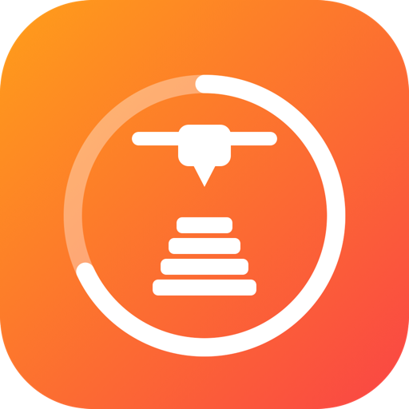
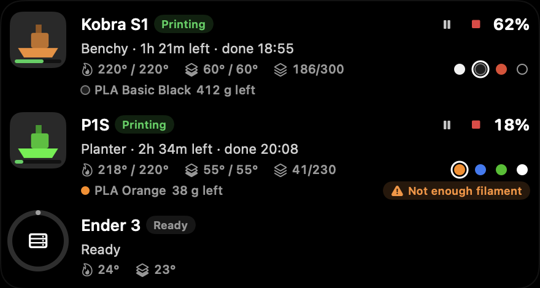
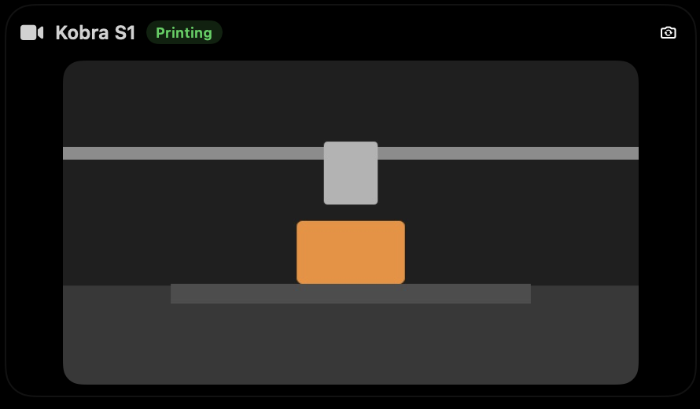

<div align="center">



# Print Live for Droppy

**Your 3D prints, live in the notch.**

A [Droppy](https://getdroppy.app) droplet that shows every 3D printer on your network, and Anycubic printers in online mode:
progress next to the notch, all printers on the shelf with preview and filament, the camera, and an alert the moment a print is done.

[](CHANGELOG.md)
[](#requirements)
[](https://getdroppy.app)
[](#octoprint)
[](#bambu-lab)
[](#anycubic)
[](#klipper)
[](#anycubic-cloud)
[](LICENSE)

</div>

---

<p align="center">
  
</p>

## Features

- 🖨️ **Five printer types**: OctoPrint, Bambu Lab, Anycubic, Klipper (Moonraker) and Anycubic Cloud, side by side
- ⏱️ **Live in the notch**: a progress ring with percent and time left, right next to the notch
- 🗂️ **Shelf overview**: every printer with preview, state, file, time left, finish time, layers, temperatures and filament slots
- 📷 **Camera**: a second shelf widget with the live picture of the current printer
- 🔔 **Notch alerts**: done, paused, failed, first layer done, 10 minutes left and a temperature warning, each one switchable
- ⏯️ **Controls**: pause, resume and stop a print from the shelf, always after a confirmation
- 🧵 **Spoolman**: remaining filament of the linked spool, with a warning when a print needs more than is left
- 📊 **History**: statistics, a 7-day chart and the last prints, stored only on this Mac
- 📋 **Menu bar**: every printer with state, percent and time left
- 🔒 **Lock screen**: progress of the current print as a line or a ring
- 🏠 **Local first**: talks to your printers on your own network, no cloud, no account
- ☁️ **Anycubic Cloud**: Anycubic printers in normal online mode, without LAN mode, using your account's web token
- 🔑 **Keychain**: API keys, access codes and tokens are stored in the macOS Keychain
- 🌍 **Six languages**: English, Deutsch, Français, Español, Italiano, Nederlands

## Screenshots

| In the notch | On the Dynamic Island |
| :---: | :---: |
|  |  |

<p align="center">
  <br>
  <sub>The live camera on the shelf</sub>
</p>

<p align="center">
  <br>
  <sub>The alert when a print is done</sub>
</p>

<p align="center">
  <br>
  <sub>Progress on Droppy's lock screen</sub>
</p>

<details>
<summary><b>Settings</b></summary>
<br>
<p align="center"></p>
</details>

## Supported printers

| | Connection | What you need |
| --- | --- | --- |
| <a id="octoprint"></a>**OctoPrint** | REST API over HTTP | Address (for example `octopi.local`) and an API key |
| <a id="bambu-lab"></a>**Bambu Lab** (X1, P1, A1 series) | Local MQTT over TLS, port 8883 | LAN mode on, IP address, serial number, access code |
| <a id="anycubic"></a>**Anycubic** (Kobra S1, Kobra 3 and other models with LAN mode) | Local handshake on port 18910, then MQTT over TLS on port 9883 | LAN mode on, IP address |
| <a id="klipper"></a>**Klipper** (Moonraker, for example Mainsail, Fluidd, Creality K1, Sovol) | REST API over HTTP, port 7125 | Address (for example `mainsailos.local`), optional API key |
| <a id="anycubic-cloud"></a>**Anycubic Cloud** (Kobra S1 and other Anycubic printers in online mode) | Anycubic's web API over HTTPS, polled every 30 to 60 seconds | Web token of your Anycubic account, optional printer name |

Print Live reads the status of every printer. It only sends a command when you press pause, resume or stop on the shelf and confirm it. It never starts a print.

## Camera

Add the **Camera** widget to the shelf to see the live picture of the printer that is printing. With more than one printer with a camera, a small button in the widget switches between them. The stream only runs while the widget is on screen and stops when the shelf closes.

| Printer | Camera |
| --- | --- |
| OctoPrint | MJPEG stream of the configured webcam |
| Klipper (Moonraker) | MJPEG stream of the configured webcam |
| Bambu Lab P1 and A1 series | Camera stream on port 6000, LAN mode required |
| Bambu Lab X1 and H2 series | **Not supported.** These models stream over RTSP, which Print Live can't show yet |
| Anycubic (LAN mode) | Shown when the printer offers a stream Print Live can read |
| Anycubic Cloud | **Not possible.** Anycubic Cloud streams video through a proprietary service. Use LAN mode for the camera |

## Alerts

Print Live shows a card in the notch when:

- a print is **done**, **paused** or **fails or is stopped**
- the **first layer is done**, once per print, when the second layer starts
- **10 minutes are left**, once per print
- the **nozzle stays more than 15 °C below its target** for a minute while printing, once per print

Every alert can be switched off under **Alerts** in the settings. The temperature warning is off by default.

## Controls

While a print runs, the shelf row shows **pause** or **resume** and **stop** for printers that support it (OctoPrint, Bambu Lab, Anycubic, Klipper and Anycubic Cloud).

> [!IMPORTANT]
> Stopping a print can't be undone. Print Live always asks for confirmation before it stops or pauses a print. If the printer doesn't accept the command, a short alert tells you so.

## Spoolman

Print Live can read your spools from [Spoolman](https://github.com/Donkie/Spoolman).

1. Enter the address of your Spoolman server under **Spoolman** in the settings, for example `http://192.168.1.11:3001`, and press **Test**.
2. Edit a printer and choose its **Spool**.
3. The shelf row shows the spool name and the grams left. When the slicer told the printer how much filament the print needs and the spool has less, the row shows **Not enough filament**.

Spool data refreshes every minute while a printer prints and every five minutes otherwise. The filament check needs a printer that reports the filament weight of the job, which not every printer or slicer does.

## History

Every print that finishes, fails or is stopped while Print Live runs is added to the history under **History** in the settings: number of prints, success rate, total print time, filament used, a chart of the last 7 days and the last ten prints. The history is stored only on this Mac and can be cleared with **Clear history**.

## Menu bar

Print Live adds an item to the menu bar that lists every printer with its state, percent and time left.

## Requirements

- macOS 14 Sonoma or later
- [Droppy](https://getdroppy.app) 15.3 or later
- Printers on the same network as your Mac (Anycubic Cloud only needs internet access)

## Installation

1. Download **`PrintLive.droplet.zip`** from the [latest release](https://github.com/janluca22467/droppy-3dprint/releases/latest) and unzip it.
2. In Droppy, open **Settings › Store › Local droplets** and drop **`PrintLive.droplet`** onto it.
3. Approve the droplet when Droppy asks.

> [!TIP]
> Try it first in the free [Droppy Playground](https://getdroppy.app/download/playground):
> copy the bundle to `~/Library/Application Support/Droppy Playground/Droplets/print-live/` and relaunch the Playground.

## Setup

Open **Print Live** in Droppy's settings and choose **Add printer**.

### OctoPrint

1. In OctoPrint, open **Settings › Application Keys** and create a key.
2. Enter the address of your OctoPrint, for example `octopi.local` or `192.168.1.30`, and paste the key.

### Bambu Lab

1. On the printer, open **Settings › Network** and turn on **LAN mode**.
2. Note the **IP address**, the **access code** and the **serial number** (Settings › Device).
3. Enter all three in Print Live.

### Anycubic

1. On the printer, turn on **LAN mode**.
2. Enter the printer's **IP address**. Print Live reads everything else from the printer.

### Klipper (Moonraker)

1. Make sure Moonraker is running. It comes with Mainsail, Fluidd and printers such as the Creality K1 or Sovol.
2. Enter the address, for example `mainsailos.local` or `192.168.1.60`. Port 7125 is used unless you add another one, for example `mainsailos.local:7130`.
3. If Moonraker requires an API key, paste it. Otherwise leave the field empty.

### Anycubic Cloud (online mode)

Use this when your Anycubic printer stays in normal online mode and LAN mode is off.

1. Sign in at [cloud-universe.anycubic.com](https://cloud-universe.anycubic.com) in your browser.
2. Open the browser's developer console and run `window.localStorage["XX-Token"]`.
3. Copy the value without the quotes and paste it as **Web token**.
4. If your account has more than one printer, enter its name as **Printer name**. Otherwise leave it empty and the first printer is used.

When the token expires, Print Live shows *Token expired, paste a new one*. Repeat the steps and paste the new token.

> [!NOTE]
> Anycubic Cloud uses Anycubic's unofficial web API. Anycubic can change it at any time, which may break this printer type until Print Live is updated.

## Privacy

- Print Live connects only to the addresses you enter. It makes no other network connections.
- API keys, access codes and tokens are stored in the macOS Keychain on this Mac.
- OctoPrint, Bambu Lab, Anycubic and Klipper printers stay local. Nothing is sent to Anycubic, Bambu Lab or any other cloud.
- Anycubic Cloud is the only exception: it talks to Anycubic's servers with your token to read the printer status and to send the pause, resume or stop commands you confirm.
- The print history and the Spoolman link are stored only on this Mac. Spoolman is contacted only at the address you enter.

## Troubleshooting

| Problem | Fix |
| --- | --- |
| *Not reachable* | Check the address and that the Mac and printer are on the same network |
| *API key rejected* | Create a new application key in OctoPrint, or check the Moonraker API key |
| *Klipper is not ready* | Moonraker answers, but Klipper is not running or reports an error. Check Mainsail or Fluidd |
| *Access code rejected* | The Bambu access code changes when LAN mode is toggled. Enter the current one |
| *Printer is in cloud mode. Add it as Anycubic Cloud* | The Anycubic printer is not in LAN mode. Switch it to LAN mode, or add it as Anycubic Cloud |
| *Token expired, paste a new one* | The Anycubic Cloud token is no longer valid. Get a new one as described above |
| *Anycubic Cloud is busy, retrying* | Anycubic's servers rejected the request for now. Print Live tries again in two minutes |
| *No printer found in this account* | Check the printer name, or leave it empty to use the first printer of the account |
| *Spoolman is not reachable* | Check the address and port of your Spoolman server and that it is on the same network |
| No camera picture | Check that the printer's webcam works in OctoPrint, Mainsail or Fluidd. Bambu X1 and H2 and Anycubic Cloud have no camera in Print Live |
| Nothing in the notch | The notch only shows a printer while it prints, and for ten minutes after it is done |

## Build from source

Print Live is a Swift package built with [DroppyKit](https://getdroppy.app/docs/droppykit).

```bash
git clone https://gitlab.com/droppyformac1/droppykit.git
export PATH="$PWD/droppykit/Scripts:$PATH"

git clone https://github.com/janluca22467/droppy-3dprint.git
cd droppy-3dprint
droppykit build
droppykit validate
droppykit run
```

<details>
<summary><b>Project layout</b></summary>

```
droplet.json                     manifest: id, version, capabilities, surfaces
Package.swift                    the droplet library and its harness
Sources/PrintLive/
  PrintLiveDroplet.swift         printers, state, notch, shelf, alerts, lock screen
  PrinterModels.swift            printer settings and print status
  OctoPrintConnection.swift      OctoPrint REST client
  BambuConnection.swift          Bambu Lab local MQTT client
  AnycubicConnection.swift       Anycubic LAN handshake and MQTT client
  MoonrakerConnection.swift      Klipper (Moonraker) REST client
  AnycubicCloudConnection.swift  Anycubic Cloud web API client
  MQTTClient.swift               small MQTT 3.1.1 client over TLS
  PrintViews.swift               notch, shelf, alert and menu bar views
  CameraWidget.swift             camera shelf widget
  CameraFeeds.swift              MJPEG and snapshot camera streams
  BambuCameraFeed.swift          Bambu Lab P1 and A1 camera stream
  PreviewImageLoader.swift       print preview loading and filament dots
  SpoolmanClient.swift           Spoolman REST client
  PrintHistory.swift             print history and statistics
  PrintLiveSettings.swift        settings page
  SettingsSections.swift         Spoolman and history settings
  Demo.swift                     demo data for the harness
  SecretStore.swift              Keychain storage
  Localization.swift             the six languages
PrintLive.icon/                  app icon
```
</details>

## License

[MIT](LICENSE) © [Jan-Luca](https://github.com/janluca22467)

Print Live is an independent project and is not affiliated with Droppy, OctoPrint, Bambu Lab, Anycubic, Klipper or Moonraker.
