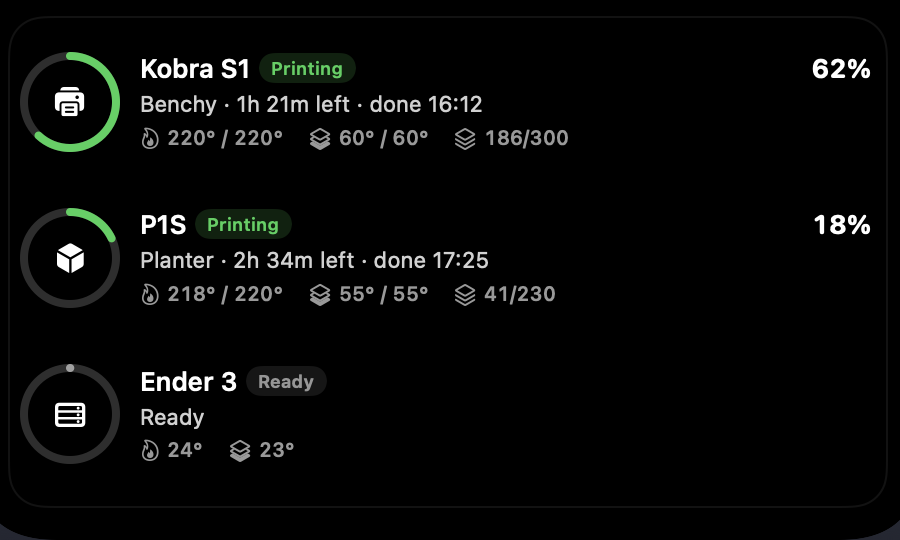
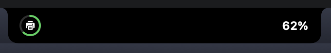
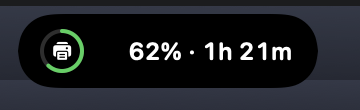
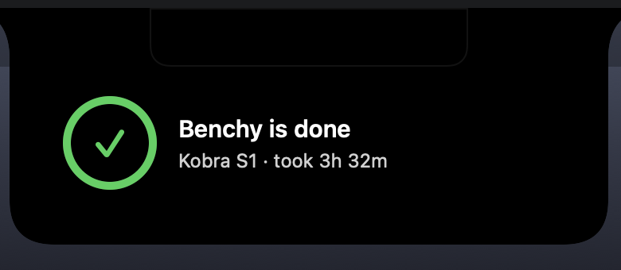
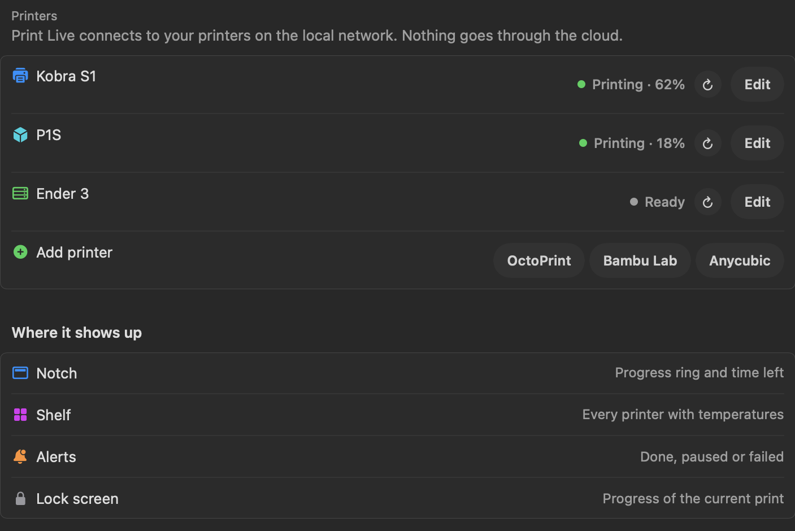

<div align="center">


# Print Live for Droppy

**Your 3D prints, live in the notch.**

A [Droppy](https://getdroppy.app) droplet that shows every 3D printer on your network:
progress next to the notch, all printers on the shelf, and an alert the moment a print is done.

[](CHANGELOG.md)
[](#requirements)
[](https://getdroppy.app)
[](#octoprint)
[](#bambu-lab)
[](#anycubic)
[](LICENSE)

</div>

---

<p align="center">
  
</p>

## Features

- 🖨️ **Three ecosystems**: OctoPrint, Bambu Lab and Anycubic, side by side
- ⏱️ **Live in the notch**: a progress ring with percent and time left, right next to the notch
- 🗂️ **Shelf overview**: every printer with state, file, time left, finish time, layers and temperatures
- 🔔 **Notch alerts**: a card when a print is done, paused or fails
- 🔒 **Lock screen**: progress of the current print as a line or a ring
- 🏠 **Local only**: talks to your printers on your own network, no cloud, no account
- 🔑 **Keychain**: API keys and access codes are stored in the macOS Keychain
- 🌍 **Six languages**: English, Deutsch, Français, Español, Italiano, Nederlands

## Screenshots

| In the notch | On the Dynamic Island |
| :---: | :---: |
|  |  |

<p align="center">
  <br>
  <sub>The alert when a print is done</sub>
</p>

<p align="center">
  <br>
  <sub>Progress on Droppy's lock screen</sub>
</p>

<details>
<summary><b>Settings</b></summary>
<br>
<p align="center"></p>
</details>

## Supported printers

| | Connection | What you need |
| --- | --- | --- |
| <a id="octoprint"></a>**OctoPrint** | REST API over HTTP | Address (for example `octopi.local`) and an API key |
| <a id="bambu-lab"></a>**Bambu Lab** (X1, P1, A1 series) | Local MQTT over TLS, port 8883 | LAN mode on, IP address, serial number, access code |
| <a id="anycubic"></a>**Anycubic** (Kobra S1, Kobra 3 and other models with LAN mode) | Local handshake on port 18910, then MQTT over TLS on port 9883 | LAN mode on, IP address |

Print Live only **reads** status. It never starts, pauses or stops a print.

## Requirements

- macOS 14 Sonoma or later
- [Droppy](https://getdroppy.app) 15.3 or later
- Printers on the same network as your Mac

## Installation

1. Download **`PrintLive.droplet.zip`** from the [latest release](https://github.com/janluca22467/droppy-3dprint/releases/latest) and unzip it.
2. In Droppy, open **Settings › Store › Local droplets** and drop **`PrintLive.droplet`** onto it.
3. Approve the droplet when Droppy asks.

> [!TIP]
> Try it first in the free [Droppy Playground](https://getdroppy.app/download/playground):
> copy the bundle to `~/Library/Application Support/Droppy Playground/Droplets/print-live/` and relaunch the Playground.

## Setup

Open **Print Live** in Droppy's settings and choose **Add printer**.

### OctoPrint

1. In OctoPrint, open **Settings › Application Keys** and create a key.
2. Enter the address of your OctoPrint, for example `octopi.local` or `192.168.1.30`, and paste the key.

### Bambu Lab

1. On the printer, open **Settings › Network** and turn on **LAN mode**.
2. Note the **IP address**, the **access code** and the **serial number** (Settings › Device).
3. Enter all three in Print Live.

### Anycubic

1. On the printer, turn on **LAN mode**.
2. Enter the printer's **IP address**. Print Live reads everything else from the printer.

## Privacy

- Print Live connects only to the addresses you enter. It makes no other network connections.
- API keys and access codes are stored in the macOS Keychain on this Mac.
- Nothing is sent to Anycubic, Bambu Lab or any other cloud.

## Troubleshooting

| Problem | Fix |
| --- | --- |
| *Not reachable* | Check the address and that the Mac and printer are on the same network |
| *API key rejected* | Create a new application key in OctoPrint |
| *Access code rejected* | The Bambu access code changes when LAN mode is toggled. Enter the current one |
| *Turn on LAN mode on the printer* | The Anycubic printer is in cloud mode. Switch it to LAN mode |
| Nothing in the notch | The notch only shows a printer while it prints, and for ten minutes after it is done |

## Build from source

Print Live is a Swift package built with [DroppyKit](https://getdroppy.app/docs/droppykit).

```bash
git clone https://gitlab.com/droppyformac1/droppykit.git
export PATH="$PWD/droppykit/Scripts:$PATH"

git clone https://github.com/janluca22467/droppy-3dprint.git
cd droppy-3dprint
droppykit build
droppykit validate
droppykit run
```

<details>
<summary><b>Project layout</b></summary>

```
droplet.json                   manifest: id, version, capabilities, surfaces
Package.swift                  the droplet library and its harness
Sources/PrintLive/
  PrintLiveDroplet.swift       printers, state, notch, shelf, alerts, lock screen
  PrinterModels.swift          printer settings and print status
  OctoPrintConnection.swift    OctoPrint REST client
  BambuConnection.swift        Bambu Lab local MQTT client
  AnycubicConnection.swift     Anycubic LAN handshake and MQTT client
  MQTTClient.swift             small MQTT 3.1.1 client over TLS
  PrintViews.swift             notch, shelf and alert views
  PrintLiveSettings.swift      settings page
  SecretStore.swift            Keychain storage
  Localization.swift           the six languages
PrintLive.icon/                app icon
```
</details>

## License

[MIT](LICENSE) © [Jan-Luca](https://github.com/janluca22467)

Print Live is an independent project and is not affiliated with Droppy, OctoPrint, Bambu Lab or Anycubic.
